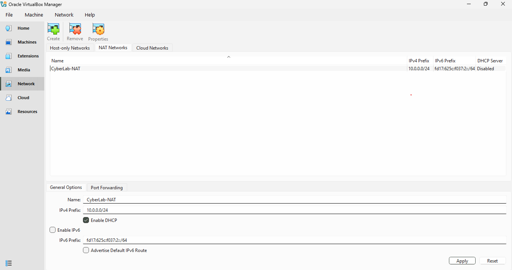
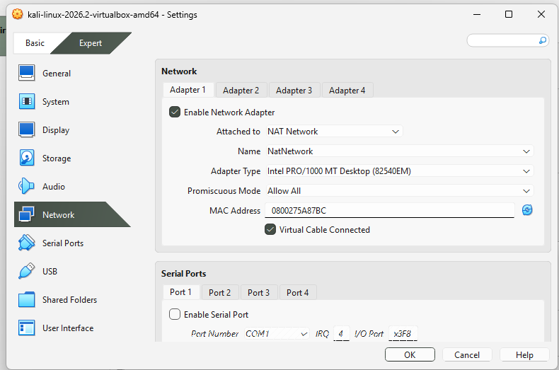
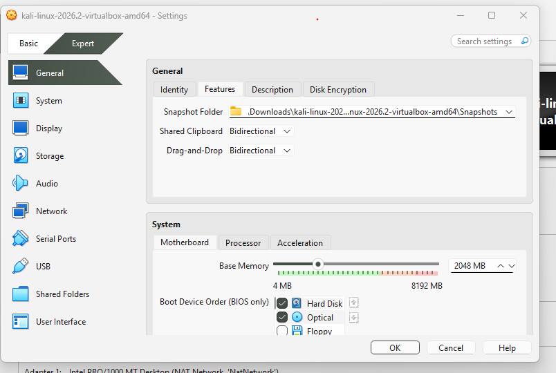
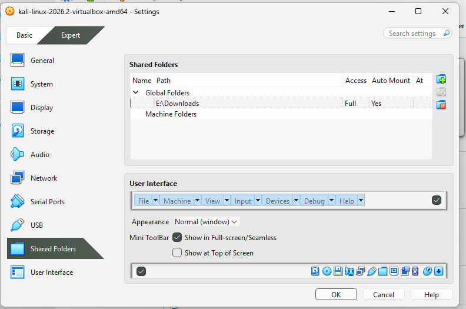
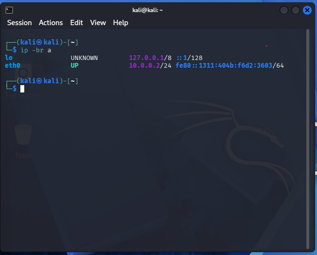
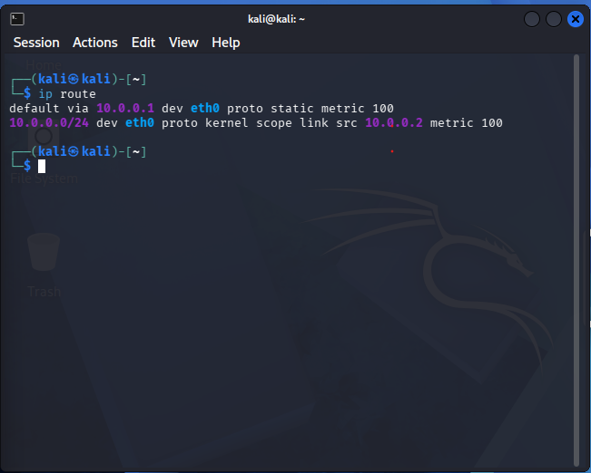
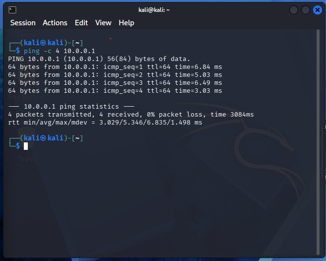
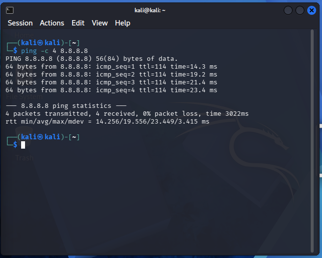
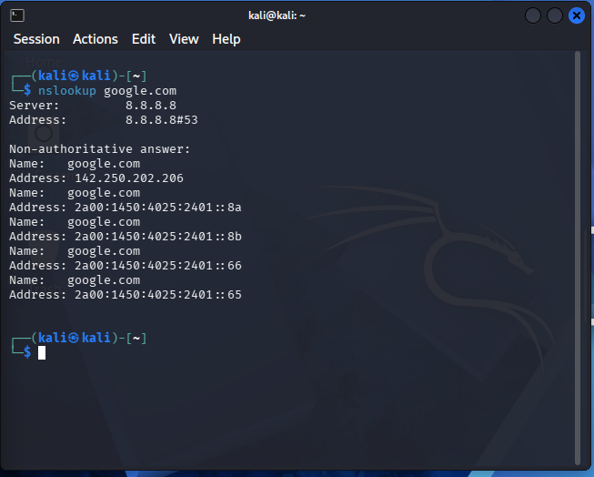

# NETWORKWALKS-MUTSIIRWA-B084-WK1-PM1-CYBERSECURITY-LAB-SETUP


## 1. Project Overview
This repository documents my Week 1 cybersecurity lab setup for NetworkWalks.
The purpose of the project was to build a virtual environment for cybersecurity practice using Oracle VirtualBox and Kali Linux.
The lab requirements included creating a custom NAT Network, assigning a static IPv4 address to Kali Linux, and confirming internet connectivity.
I also checked the routing table, tested access to the gateway, and verified that DNS resolution was working.
Screenshots are included as evidence of the configuration and test results.
This repository serves as a record of the practical work completed for assignment WK1-PM1.
It also provides a foundation for continuing with Linux, networking, and cybersecurity exercises.

## 2. Project Objectives
The main objectives of this project were to:

- Install and configure Oracle VirtualBox.
- Import Kali Linux as the virtual machine used for cybersecurity practice.
- Create a NAT Network named `NatNetwork`.
- Use the IPv4 subnet `10.0.0.0/24`.
- Configure Kali Linux with the required static address `10.0.0.2/24`.
- Use `10.0.0.1` as the default gateway.
- Configure a DNS server for name resolution.
- Verify the interface address using Linux networking commands.
- Inspect the routing table.
- Test connectivity to the gateway.
- Test external IP connectivity.
- Test DNS resolution.
- Configure shared clipboard and drag-and-drop settings as required by the assignment.
- Configure a shared folder for the Windows Downloads folder.
- Capture screenshots documenting the setup.

## 3. Lab Environment

| Component | Configuration |
|---|---|
| Host operating system | Windows |
| Virtualization software | Oracle VirtualBox |
| Virtual machine | Kali Linux |
| Network attachment | NAT Network |
| NAT Network name | `NatNetwork` |
| IPv4 subnet | `10.0.0.0/24` |
| Kali Linux IPv4 address | `10.0.0.2/24` |
| Default gateway | `10.0.0.1` |
| DNS server | `8.8.8.8` |
| Gateway connectivity | Tested successfully |
| External IP connectivity | Tested successfully |
| DNS resolution | Tested successfully |
| Shared folder requirement | Windows Downloads folder |
| Clipboard requirement | Bidirectional |
| Drag-and-drop requirement | Bidirectional |

## 4. Network Design
The lab uses a custom NAT Network in VirtualBox.
The configured network is `10.0.0.0/24`.
The subnet mask for this prefix is `255.255.255.0`.
Kali Linux uses the static IPv4 address `10.0.0.2`.
The default gateway is configured as `10.0.0.1`.
The DNS server used for testing is `8.8.8.8`.
The NAT Network provides the virtual network connection used by this lab.
The gateway and internet tests were performed from inside Kali Linux.
The results are recorded in the evidence screenshots below.

## 5. Implementation and Evidence
The following steps describe the setup process and the checks carried out.
Each screenshot is stored in the root of this repository.
The Markdown image links therefore use the image filenames directly.

### Step 1: Install and Configure VirtualBox
Oracle VirtualBox provides the virtualization platform for this project.
It allows Kali Linux to run as a virtual machine on the Windows host.
This means Kali Linux can be used for practical exercises without replacing Windows as the main operating system.
The VirtualBox installation or version screenshot is included below.


### Step 2: Create the NAT Network
A custom NAT Network named `NatNetwork` was created in VirtualBox.
The network uses the required IPv4 subnet `10.0.0.0/24`.
The configured gateway is `10.0.0.1`.
DHCP was enabled in the VirtualBox network configuration.
The static address for Kali Linux was configured separately in the guest operating system.
This network configuration matches the addressing plan specified in the assignment.



### Step 3: Connect Kali Linux to the NAT Network
The Kali Linux virtual machine was attached to the custom `NatNetwork`.
The virtual network adapter was enabled and its virtual cable was connected.
Selecting the correct network is important because the guest IP configuration depends on the network to which the adapter is attached.
The screenshot below records the adapter settings used for the lab.



### Step 4: Configure Shared Clipboard and Drag-and-Drop
The assignment specifies bidirectional shared clipboard and drag-and-drop.
These options are intended to make it easier to transfer text and files between Windows and Kali Linux.
The relevant VirtualBox settings are shown in the screenshot below.
The settings should be tested from the running guest to confirm that the features operate as expected.
VirtualBox Guest Additions may be required for these integrations to work correctly.



### Step 5: Configure the Shared Folder
The assignment requires the Windows Downloads folder to be shared with Kali Linux.
A shared folder provides a convenient way to move permitted lab files between the host and the virtual machine.
The screenshot below documents the shared-folder settings.
After configuring the folder, access should be checked inside Kali Linux to confirm that it is available.



### Step 6: Configure and Verify the Kali Linux IP Address
Kali Linux was configured with the required static IPv4 address `10.0.0.2/24`.
The command below displays the network interfaces and their addresses in a compact format.

```bash
ip -br a
```

The `eth0` interface showed `10.0.0.2/24` after the static configuration was applied.
The `/24` prefix corresponds to the subnet mask `255.255.255.0`.
This places the address in the required `10.0.0.0/24` network.



### Step 7: Verify the Routing Table
The routing table was checked using the following command.

```bash
ip route
```

The output showed a default route through `10.0.0.1`.
It also showed the directly connected `10.0.0.0/24` network.
The routing table helps explain where Kali Linux sends traffic for local and remote destinations.
The expected routes were present during verification.



### Step 8: Test Gateway Connectivity

The gateway was tested with the following command.

```bash
ping -c 4 10.0.0.1
```

The command sends four ICMP echo requests to the configured gateway.
All four packets received replies, resulting in zero packet loss.
This confirmed that Kali Linux could reach the gateway during the test.
Testing the gateway first helps distinguish a local network issue from a problem reaching an external destination.



### Step 9: Test Internet Connectivity

External IP connectivity was tested using the public address `8.8.8.8`.
The command used was:

```bash
ping -c 4 8.8.8.8
```

All four packets received replies, with zero packet loss.
This confirmed that external IP connectivity was working at the time of testing.
Testing an IP address directly avoids relying on DNS for this particular check.



### Step 10: Verify DNS Resolution

DNS resolution was tested with the following command.

```bash
nslookup google.com
```

The configured DNS server was `8.8.8.8`.
The command returned IPv4 and IPv6 addresses for `google.com`.
This confirmed that domain-name resolution was working during the test.
DNS allows applications to use domain names instead of requiring users to remember IP addresses.



## 6. Commands Used for Verification

The following commands were used during network configuration and testing.

### Display interface addresses

```bash
ip -br a
```

This command lists network interfaces and their assigned addresses.
It is useful for checking whether the expected IPv4 address is present.

### Display the routing table

```bash
ip route
```

This command shows connected routes and the default gateway.
It helps verify how the system will route traffic to different destinations.

### Test the gateway

```bash
ping -c 4 10.0.0.1
```

This command checks whether the gateway responds to ICMP echo requests.

### Test external IP connectivity

```bash
ping -c 4 8.8.8.8
```

This command tests access to an external IP address without requiring a DNS lookup.

### Test DNS resolution

```bash
nslookup google.com
```

This command asks the configured DNS server to resolve the domain name.

## 7. Problems Encountered and Solutions

### Duplicate IP Address Detection

During the initial configuration, NetworkManager refused to activate the connection after the static address `10.0.0.2` was assigned.
The message indicated that another device on the network was responding for the requested address.
This prevented the connection from activating with the required static IP.

### Solution

The troubleshooting instructions supplied with the assignment recommended setting the NetworkManager IPv4 duplicate-address detection timeout to zero for this scenario.
The command used was:

```bash
sudo nmcli connection modify "Wired connection 1" ipv4.dad-timeout 0
```

The connection was then deactivated and reactivated.

```bash
sudo nmcli connection down "Wired connection 1"
sudo nmcli connection up "Wired connection 1"
```

After applying the setting, Kali Linux successfully activated with `10.0.0.2/24`.
The gateway, external IP, and DNS tests then succeeded.

## 8. Test Results Summary

| Test | Command | Result |
|---|---|---|
| Interface address | `ip -br a` | `10.0.0.2/24` shown on `eth0` |
| Routing table | `ip route` | Default route via `10.0.0.1` |
| Gateway connectivity | `ping -c 4 10.0.0.1` | 4 replies, 0% packet loss |
| Internet connectivity | `ping -c 4 8.8.8.8` | 4 replies, 0% packet loss |
| DNS resolution | `nslookup google.com` | Domain resolved successfully |

These results reflect the tests performed during the lab setup.
Network status can change, so the commands may be run again if connectivity issues arise later.

## 9. What I Learned

This project gave me practical experience with VirtualBox and Kali Linux.
I learned how to create and use a NAT Network with a specified IPv4 subnet.
I practised assigning a static address using NetworkManager.
I also learned to inspect interface addresses and routing information from the terminal.
The connectivity tests helped me understand the difference between gateway reachability, external IP connectivity, and DNS resolution.
Troubleshooting the duplicate-address detection issue showed the importance of reading error messages and verifying a change after applying it.
These skills will be useful in future networking and cybersecurity practicals.

## 10. Conclusion

This project established the core network configuration for a cybersecurity testing lab using Oracle VirtualBox and Kali Linux.
The required network `10.0.0.0/24` was configured, and Kali Linux was assigned the static address `10.0.0.2/24` with gateway `10.0.0.1`.
Testing confirmed that the gateway was reachable, external IP connectivity was available, and DNS resolution was functioning at the time of testing.
The project also provided hands-on experience in configuring a virtual network, inspecting routing information, and troubleshooting a network activation issue.
The screenshots in this repository document the main setup steps and provide evidence of the tests performed.
Configuring and testing shared clipboard, drag-and-drop, and shared-folder access remain separate items to verify if they have not yet been tested successfully.
This lab provides a foundation for continuing my cybersecurity training and carrying out more advanced practical exercises.

## 11. Author

**Name:** MUTSIIRWA MATEMBERA JOSUE

**Batch:** B084  
**Assignment:** WK1-PM1  
**Program:** Cybersecurity Internship  
**Organization:** NetworkWalks  

**LinkedIn:** [Connect with me on LinkedIn](https://www.linkedin.com/in/josue-matembera-37a269407/)
